# Phase 1 Technical Report

## A Comparative Study of RAG Techniques for Generating Image Captions

**Release:** g1-v1.2 (frozen artifacts: g1-v1.1; official test set: 1,000 images)  
**Prepared for:** Phase 1 handoff and shared-data use  
**Report owner:** Sarah

---

## Abstract

Phase 1 establishes a frozen, shared data foundation for comparative retrieval-augmented image-captioning research on MS COCO 2017. The implemented release contains 10,000 knowledge-base (KB) images with 50,000 captions, 100 validation images with 500 reference captions, and 100 test images with 500 reference captions. The pipeline constructs normalized images, captions, object and relational metadata, image and text embeddings, exact and approximate FAISS indexes, exploratory statistics, quality-control evidence, and a release manifest. Anti-leakage controls combine disjoint split construction, content-level audit checks, duplicate repair, near-duplicate screening, and an ID-level retrieval guard.

Four retrieval configurations were evaluated in the first Phase 1 design, and the SigLIP extension added a fifth configuration. Validation nearest-neighbour CIDEr identified SigLIP image-to-text retrieval (0.7223) as the best implemented configuration; SigLIP image-to-image obtained 0.6735, followed by CLIP image-to-text (0.5584), DINOv2 image-to-image (0.5541), and CLIP image-to-image (0.5286). SigLIP image-to-image did not differ significantly from SigLIP image-to-text (Wilcoxon \(p=0.3023\)), whereas the CLIP image-to-text, DINOv2, and CLIP image-to-image comparisons were significant under the repository's four-comparison Bonferroni threshold of 0.0125. The test splits remained report-only. On the legacy 100-image test, SigLIP image-to-text obtained CIDEr 0.7064, also the highest value. The official final test set is a 1,000-image COCO val2017 sample (disjoint from the KB, the validation split and the legacy test); there too SigLIP image-to-text is highest (CIDEr 0.6385), followed by CLIP image-to-text (0.5746). An earlier version of this report showed a different ranking (SigLIP image-to-text lowest, 0.4645), which is reproduced exactly by SigLIP text embeddings recomputed with padding=True instead of the padding="max_length" setting of notebook 04 (Section 11.3). The encoder was selected on validation and was not re-selected on the test. The 100-image test of the frozen release g1-v1.1 is kept unchanged as a legacy set.

**Keywords:** MS COCO, image captioning, retrieval-augmented generation, CLIP, DINOv2, SigLIP, Sentence-BERT, FAISS, data leakage.

## Table of Contents

1. Introduction and problem statement  
2. Dataset description  
3. Dataset splitting and stratification  
4. Exploratory data analysis  
5. Image and caption preprocessing  
6. Metadata extraction  
7. Data quality assessment and anti-leakage measures  
8. Image and text embeddings  
9. Knowledge base and FAISS index construction  
10. Encoder comparison and validation-based selection  
11. Experimental results and statistical analysis  
12. Reproducibility and dataset freezing  
13. Limitations and conclusion  

References

---

# 1. Introduction and Problem Statement

The objective of this project is to study retrieval-based methods for generating image captions. Image caption generation normally requires an image encoder, a language-generation model, and an image-text interface; in a retrieval-augmented formulation, the system first retrieves relevant images or captions from an external knowledge base and then uses that evidence as conditioning context. Phase 1 is a data-engineering and benchmarking phase rather than an implementation of the final caption generator. It therefore prepares a common, verified corpus and the retrieval infrastructure that later groups can use consistently.

Phase 1 addresses three technical risks. First, a shared corpus is needed so that later experiments compare retrieval and generation methods rather than different datasets. Second, evaluation leakage can invalidate an apparently strong result if an evaluation image, a near-copy, or its textual reference is present in the knowledge base. Third, encoder selection requires a documented validation procedure and must not be influenced by the final test set. The repository consequently separates data preparation, validation, and final reporting; its retrieval API exposes evaluation references only through evaluation-only files.

The scientific deliverable is not a claim that Phase 1 itself generates captions. Instead, it supplies a retrieval baseline using nearest-neighbour candidates and compares candidate captions with reference captions. This distinction is reflected in the experimental vocabulary: an image-to-image configuration retrieves KB images and then uses an associated caption, while an image-to-text configuration retrieves a KB caption vector directly. Both can serve as precursor evidence for later retrieval-augmented generation.

# 2. Dataset Description

The project uses MS COCO 2017. COCO provides images with object-instance annotations and five or more human-authored captions associated with many images. Release g1-v1.1 is restricted to the implemented Phase 1 sizes documented in [Table 1](#table-1-release-composition). The KB contains 10,000 images and 50,000 retained captions, whereas validation and test each contain 100 images and 500 raw reference-caption rows.

**Table 1. Release composition.**

| Split | Source | Images | Captions/references |
|---|---|---:|---:|
| Knowledge base | COCO train2017 | 10,000 | 50,000 KB captions |
| Validation | COCO train2017 | 100 | 500 references |
| Test | COCO val2017 | 100 | 500 references |
| **Total** |  | **10,200** | **51,000** |

Table 1 directly restates the frozen split metadata, EDA counts, and evaluation files. The KB and validation originate from non-overlapping selections of COCO train2017, while the test selection originates from COCO val2017. This composition avoids an unnecessary download of the full image archive: only the approximately 10,200 images belonging to a frozen split are designated for acquisition.

The repository records two forms of captions. The KB has `caption_raw`, `caption_clean`, and `n_tokens`; the evaluation splits retain raw references in separate JSONL files. Each KB image has exactly five captions after selection. Thus the target release preserves a fixed reference-cardinality structure even when a COCO image has more than five source captions.

## Specification ambiguity

The project specification is internally inconsistent about the test size: sections 4.1/4.2 specify 100 test images, while sections 4.4.2/4.4.3 describe 1,000. The instructor indicated verbally that the test set must contain **1,000 images** (no written confirmation is on record), so the official evaluation set is the 1,000-image val2017 sample defined in `experiments/test_1000_val2017/` and the decision is recorded in [reports/split_confirmation.json](reports/split_confirmation.json). The frozen release g1-v1.1 was built with a 100-image test (sections 4.1/4.2); that legacy test is kept unchanged (hashes in `experiments/test_1000_val2017/manifests/verification.json`) and is reported as a secondary, small-sample check. Where this report says "test" without qualification in Sections 2–11.2, it refers to the legacy 100-image test; Section 11.3 reports the official 1,000-image test.

# 3. Dataset Splitting and Stratification

## 3.1 Sampling order and eligibility

The sampling sequence is test first, validation second, and KB last. Test IDs are selected from eligible COCO val2017 images, validation IDs from eligible train2017 images, and KB IDs from train2017 after excluding validation IDs. Eligibility requires at least the configured number of object annotations, at least one caption subset, and a shorter side of at least 200 pixels. The global seed is 42; the implementation derives 43 for the test sample, 44 for validation, and 45 for the KB.

COCO images without object annotations are excluded because the pipeline's Phase 1 metadata function requires instance data. The split metadata records 1,021 such exclusions from train2017 and 225 undersized train2017 exclusions; in val2017 it records 48 unannotated images and 12 undersized images. None of the excluded images is represented by a split record.

## 3.2 Stratification algorithm

Validation and test are stratified according to scene complexity, image context, interaction level, and class coverage. Complexity is derived from the count of non-crowd COCO object annotations:

\[
\text{simple}=1\text{-}2,\quad
\text{medium}=3\text{-}5,\quad
\text{complex}=6\text{-}9,\quad
\text{crowded}\geq10.
\]

Before filling the complexity quotas, a greedy class-cover step selects up to half of the requested sample to cover COCO categories. At each iteration it prioritizes the rarest needed class and then an image covering the greatest number of other needed classes, with deterministic seeded tie-breaking. The complexity targets are 25%, 30%, 30%, and 15%, respectively. Integer rounding preserves the target total. Overfilled categories are rebalanced, while residual images are assigned to medium complexity.

An image is labelled as containing an interaction if it has a person and another class, at least two person annotations, or an animal supercategory together with another supercategory. The requested minimum is 30% of each evaluation sample. Candidate selection operates within complexity classes and follows a round-robin context rotation among indoor, outdoor, and mixed. It prioritizes interaction candidates while the global interaction minimum remains unmet.

**Table 2. Observed stratification of validation and test.**

| Split | Simple | Medium | Complex | Crowded | Indoor | Outdoor | Mixed | Interaction | Classes | Minimum/class |
|---|---:|---:|---:|---:|---:|---:|---:|---:|---:|---:|
| Validation | 25 | 30 | 30 | 15 | 35 | 35 | 30 | 69 (69%) | 80 | 1 |
| Test | 25 | 30 | 30 | 15 | 37 | 33 | 30 | 61 (61%) | 80 | 1 |

Table 2 is referenced below in the context of representativeness. Both samples attain the exact complexity quotas. Their interaction fractions exceed the 30% minimum, and both cover all 80 COCO categories present in the implementation. Validation coverage is slightly more balanced between indoor and outdoor contexts, whereas test contains 37 indoor, 33 outdoor, and 30 mixed images. The context labels are saved sampling outputs, rather than claims of a separately enforced context-count design.

The KB remains a naturally distributed sample subject to its category floor. Its split summary contains at least 66 images for each class, which is above the configured floor of 60; this distinction is intentional, because the KB should reflect retrieval prevalence rather than the equally represented evaluation quotas.

# 4. Exploratory Data Analysis

## 4.1 Dataset-scale and annotation profile

The repository's EDA report summarizes 10,200 images, 51,000 captions/references, 80 object categories in all splits, and object statistics for each split. The KB contains 80,498 object instances, based on the reproduced mean of 8.0498 objects per image. Across splits, the mean object count is 8.05 for KB, 7.74 for validation, and 6.77 for test, as shown in [Table 3](#table-3-object-summary). The distributions are right-skewed: medians are 5, 5, and 4 respectively, while maxima reach 67 in KB, 65 in validation, and 62 in test.

**Table 3. Object-content summary.**

| Split | Mean objects/image | Median | p90 | Maximum | Mean categories/image |
|---|---:|---:|---:|---:|---:|
| KB | 8.05 | 5 | 19 | 67 | 3.25 |
| Validation | 7.74 | 5 | 18 | 65 | 3.41 |
| Test | 6.77 | 4 | 15 | 62 | 3.30 |

Table 3 explains why the validation and test captions can be expected to contain more compact information than individual estimates from object counts alone: the split means differ, yet medians indicate similarly constrained central scenes. [Figure 1](#figure-1-class-distribution) presents the most frequent KB classes.

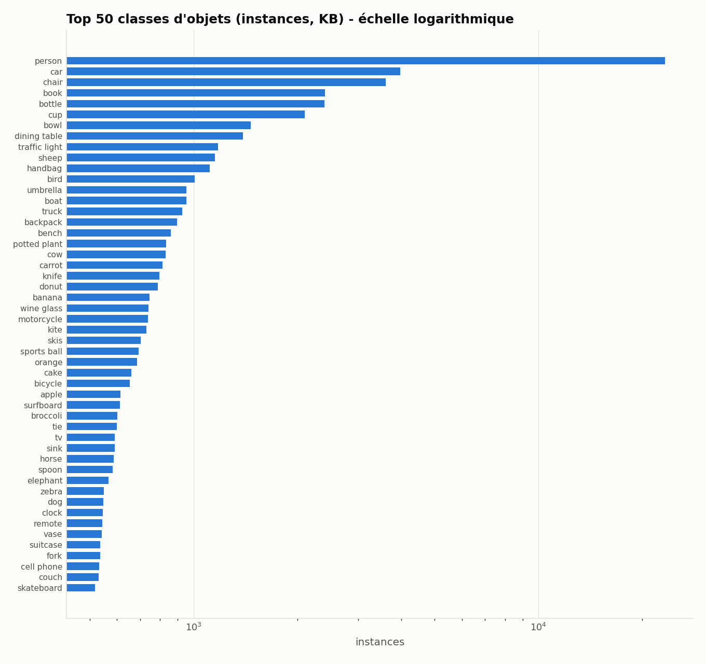

*Figure 1. The 50 most frequent classes in the KB. Values are stored in `stats.json`, with person having 23,286 instances and appearing in 5,599 images. Other prominent classes include car, chair, book, bottle, cup, bowl, dining table, traffic light, and sheep.*

As the figure indicates, person is by far the most frequent category. Its frequency motivates the project's interaction-definition emphasis, while the smaller image-level class frequencies affect class-coverage and co-occurrence analysis. [Figure 2](#figure-2-complexity) shows the scene-complexity distribution generated by the pipeline.

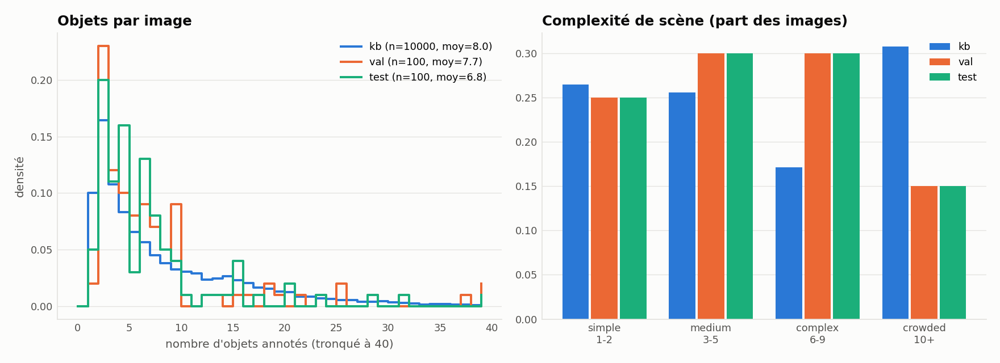

*Figure 2. Scene-complexity distributions. The KB follows a natural distribution (26.47% simple, 25.61% medium, 17.15% complex, and 30.77% crowded), whereas validation and test follow the implemented 25/30/30/15% quotas.*

The stratification explains the significant chi-square comparison between KB and test complexity, with \(\chi^2=18.3304\) and \(p=0.000376\). This is not presented as evidence of unwanted selection bias; the repository explicitly notes that the expected difference arises from the intentionally balanced test sample.

## 4.2 Spatial relations and layout

[Figure 3](#figure-3-relations) presents geometric relation frequencies. The repository derives relations by normalized bounding-box geometry, not semantic scene understanding. Left-of and right-of are complementary pair counts and occur at equal total frequencies, as do above/below and inside/contains. In the KB, the proportions are 28.668% for left/right, 10.412% for above/below, 10.351% for overlapping, 4.758% for inside/contains, and 1.973% for on-top-of; note that each inverse relation pair represents one stored relation in each directional interpretation. The same pattern holds across evaluation splits.

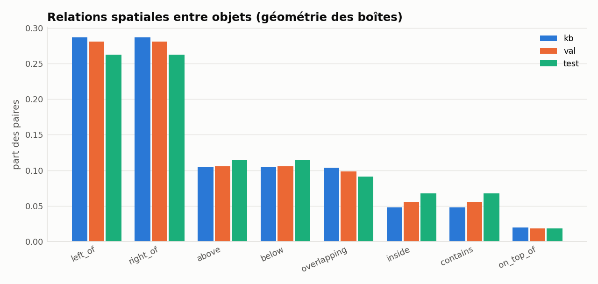

*Figure 3. Spatial relations inferred from object bounding boxes. The symmetry between directional relation pairs is geometric by construction.*

## 4.3 Captions and lexical statistics

Mean caption length is stable across splits: 10.483 KB tokens, 10.488 validation tokens, and 10.472 test tokens, with median 10 in every split. The full KB vocabulary contains 9,697 unique tokens, 3,936 hapax legomena, and 524,149 tokens. Token-level type-token ratios should not be compared directly across split sizes, because the value for KB is 0.0185, versus 0.1844 and 0.1765 for validation and test. Validation has 967 vocabulary items and the test has 924. Out-of-vocabulary rates relative to the KB are 1.09% for validation and 0.74% for test.

The repository compares KB and test caption lengths using a two-sample Kolmogorov-Smirnov statistic of \(D=0.02484\), \(p=0.9125\). This result supports the descriptive observation that caption lengths are similar despite the intentionally different stratification. [Figure 4](#figure-4-caption-length) combines caption-length and Zipf-style evidence.

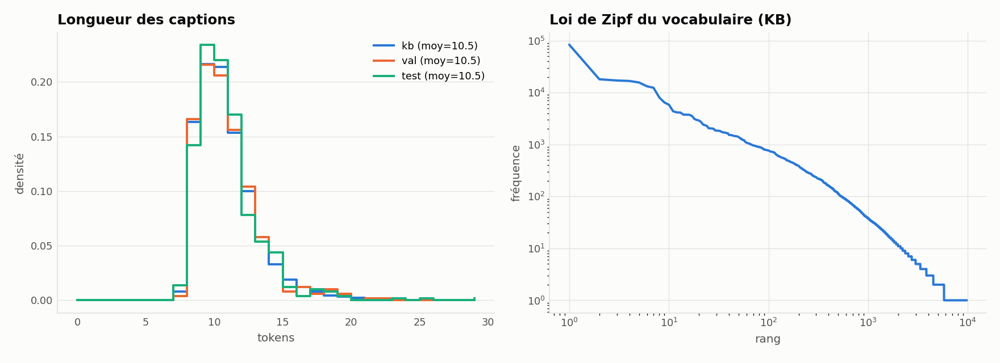

*Figure 4. Caption-length distributions and associated corpus-frequency visualization. The short caption bodies are concentrated around the same median across all splits.*

The NLTK part-of-speech distribution recorded for the KB has 74,604 nouns, 44,638 determiners, 33,596 prepositions, and 24,269 verbs, with lower counts for adjectives, pronouns, conjunctions, numerals, adverbs, particles, and unknown tags. [Figure 5](#figure-5-pos) displays the distribution.

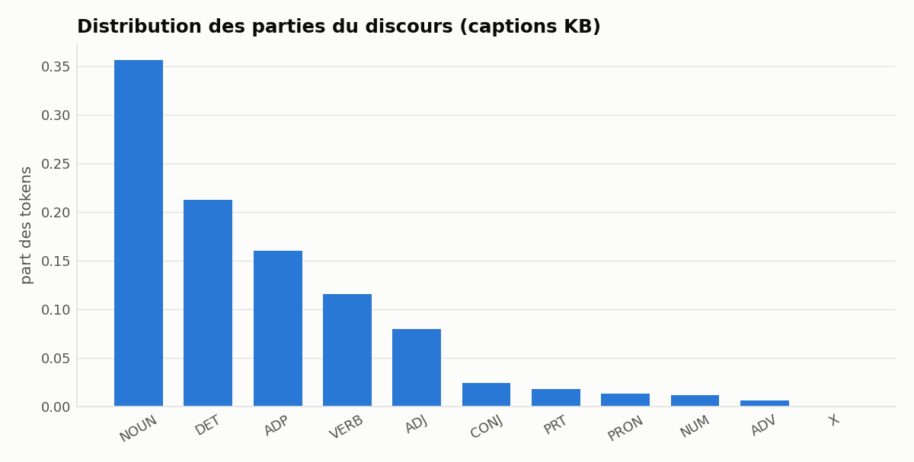

*Figure 5. Part-of-speech distribution derived from the KB captions.*

## 4.4 Co-occurrence and image-text association

The repository analyses frequent class co-occurrence and the association between object count and caption length. The recorded Spearman correlation in the KB is \(\rho=0.13858\), with \(p=4.5492\times10^{-44}\). Because the sample contains 50,000 captions, the correlation is statistically distinguishable from zero despite its small descriptive magnitude. It should not be interpreted as a direct causal relationship between scene object count and linguistic richness.

[Figure 6](#figure-6-cooccurrence) visualizes the leading class pairs. [Figure 7](#figure-7-object-caption) displays the relationship between annotation count and caption length.

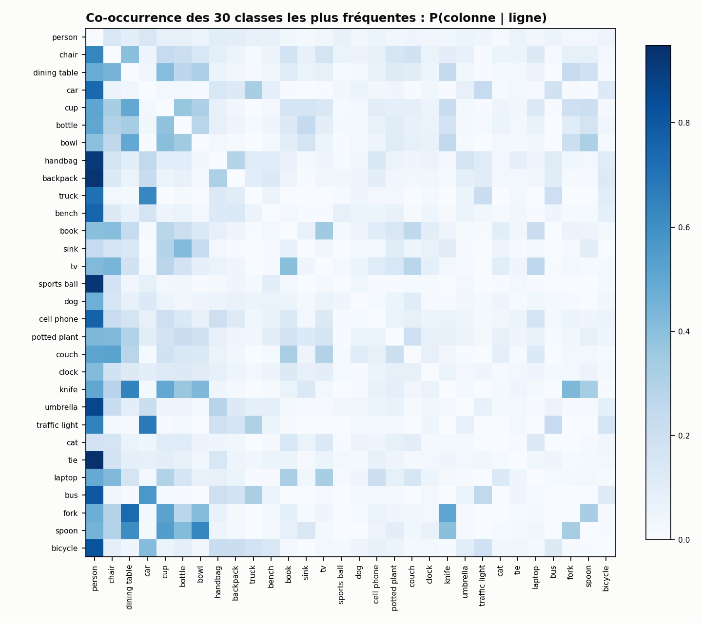

*Figure 6. Top 30 object-class co-occurrences in the KB.*

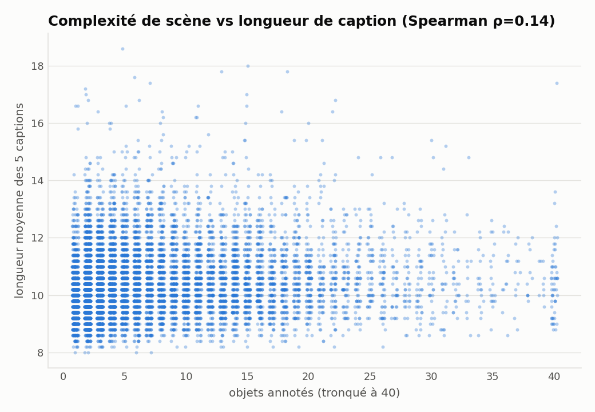

*Figure 7. Relationship between object count and caption length.*

## 4.5 Split representativeness

The Jensen-Shannon divergence of class distributions is 0.0311 for KB versus validation and 0.0313 for KB versus test, in a convention where zero denotes identical distributions. These small divergences indicate broadly similar class populations. Nevertheless, they do not demonstrate visual equivalence: validation and test are intentionally constrained samples, and their allocation differs from the KB's natural distribution.

All 80 classes occur in every split and the test has no missing class. Thus class coverage is complete at the category level, although the number of images representing each class in an evaluation split may be modest. [Figure 8](#figure-8-diversity) summarizes context, illumination, object size, and related diversity measures.

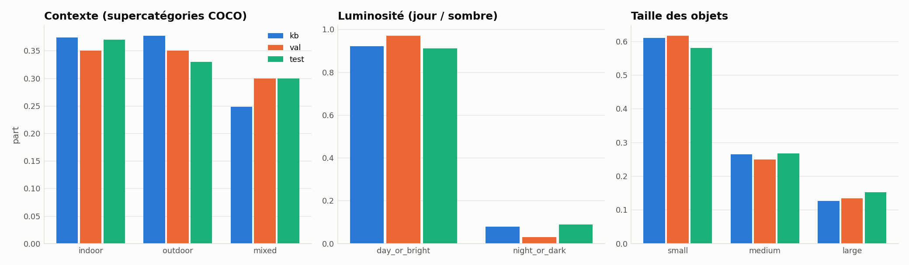

*Figure 8. Context and visual-diversity distributions across splits.*

In the KB, 92.16% of images are day/bright; in validation and test the corresponding shares are 97% and 91%. Gray is the leading dominant image colour in all splits. KB object-size shares are approximately 60.95% small, 26.42% medium, and 12.64% large. [Figure 9](#figure-9-colours) presents the colour distribution and [Figure 10](#figure-10-grid) provides the qualitative image sample grid.

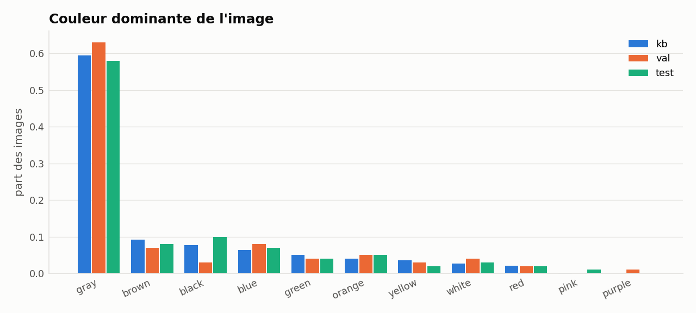

*Figure 9. Dominant visual colours by split.*

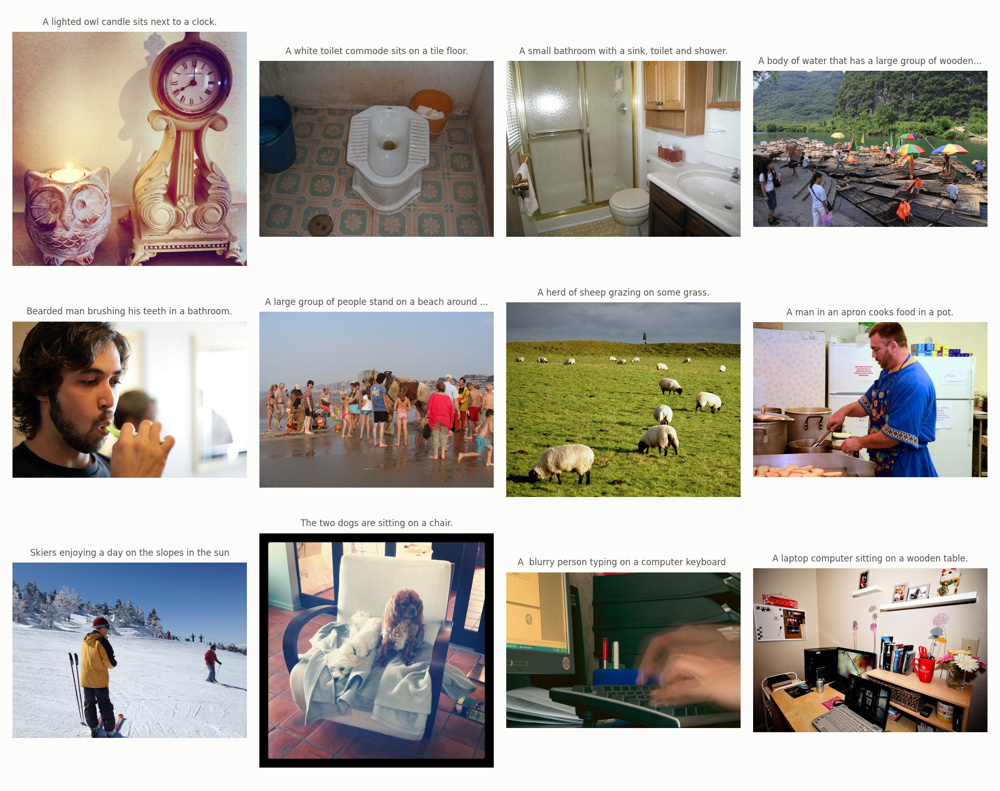

*Figure 10. Qualitative sample from the frozen release.*

Finally, the fixed caption attribute lexicon identifies colour, size, material, state, and shape expressions in KB captions. Its largest recorded category counts are 10,586 colour, 5,604 size, 2,532 state, 1,766 material, and 239 shape attributes. White is the most frequent colour attribute with 2,943 occurrences, followed by large and small. Shape counts include flat 73, round 57, square 53, circular 14, rectangular 12, and oval 9 occurrences in the figure's source data. [Figure 11](#figure-11-attributes) illustrates these distributions.

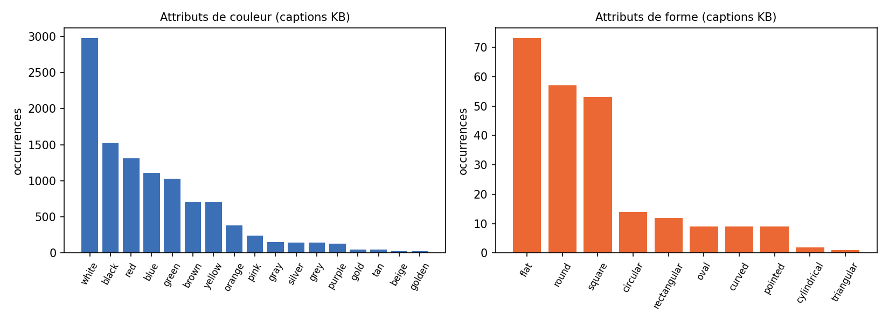

*Figure 11. Distribution of lexical colour and shape attributes in KB captions.*

# 5. Image and Caption Preprocessing

## 5.1 Image normalization

The normalization notebook verifies each image and applies EXIF orientation correction only when required. Pixel correction was recorded for no images in the frozen audit. The stored pipeline converts 24 grayscale images to RGB; the audit records 10,176 RGB source files and 24 luminance-only files, all now represented as RGB. Thus model preprocessing begins from consistent RGB inputs rather than source modes that vary by COCO file.

Images with a side larger than 512 pixels are uniformly rescaled so that the maximum side equals 512. The scale preserves aspect ratio and rounds the resulting dimensions to at least one pixel. Pillow's Lanczos resampling is used, and the normalized image is stored as JPEG quality 95 with subsampling disabled at `artifacts/images_rgb/<split>/<12-digit-id>.jpg`. Smaller images are stored without forced enlargement.

The audit derives a 64-by-64 bilinear sample and records brightness, contrast, colorfulness, sharpness, darkness, a named dominant-colour estimate, and a source SHA-256. It also stores the original and normalized dimensions, source colour mode, EXIF state, resize state, difference hash, and output path in `images.csv`.

## 5.2 Model-specific preprocessing

Stored RGB files are not rewritten by each model. CLIP and SigLIP use each checkpoint's Hugging Face processor and text-image feature methods. DINOv2 uses an AutoImageProcessor and the CLS token \(\mathbf h_{\mathrm{CLS}}=H[:,0,:]\) as the image representation. The processor configuration is not included in the frozen release, so processor-specific crop dimensions cannot be independently reconstructed from the artifacts; documentation relies on the checkpoint processor used at embedding time.

CLIP input text is tokenized with a maximum length of 77 and truncation with dynamic padding. SigLIP uses a configured maximum length of 64 with truncation and padding. These limits are preprocessing choices and are not evidence about the quality of either language model as a standalone generator.

## 5.3 Caption cleaning

For each KB image, captions are sorted by source COCO caption ID and the first five are selected. A raw string is preserved in `caption_raw`, and a cleaned string is stored in `caption_clean`. Cleaning (1) strips whitespace and converts to lowercase, (2) replaces characters outside word characters, whitespace, and apostrophes with spaces, (3) removes a quote when surrounded by spaces, and (4) collapses whitespace. Token counts are calculated from the cleaned form.

Evaluation files contain `caption_raw` only and are not used to build the KB. The separation prevents cleaning or indexing choices in an evaluation reference from becoming KB data.

# 6. Metadata Extraction

Each split is joined to COCO instance annotations and caption records. Crowd annotations are ignored. For every non-crowd object, the pipeline records COCO category identity and supercategory, normalized bounding-box coordinates, image-area fraction, and size:

\[
\text{small}:a<0.02,\quad
\text{medium}:0.02\leq a<0.15,\quad
\text{large}:a\geq0.15,
\]

where \(a\) is the object bounding-box area fraction after clipping to image bounds. For the largest objects, the pipeline estimates a named pixel colour for objects with area fraction at least 0.01, processing up to eight objects.

Top-level metadata also includes category counts, object counts, supercategories, complexity, context, day/night status, brightness, colorfulness, dominant colours, relations, and KB caption attributes. Complexity follows the thresholds in Section 3. Context is assigned through indoor/outdoor COCO supercategories. Day/night is based on the configured brightness threshold of 0.28.

Eight geometric relations—`inside`, `contains`, `on_top_of`, `overlapping`, `left_of`, `right_of`, `above`, and `below`—are calculated from bounding-box geometry among the largest objects. They are not inferred by a semantic scene graph. Caption attributes come from fixed lexicons of 17 colours, 8 materials, 10 size words, 13 states, and shape expressions.

For implementation realism, the repository's optional DETR path can supply predicted object detections. However, frozen validation/test objects in `metadata.jsonl` are COCO ground truth and therefore constitute an oracle for evaluating query metadata. This limitation is recorded explicitly and must be considered when interpreting downstream metadata-based results.

# 7. Data Quality Assessment and Anti-Leakage Measures

## 7.1 Image audit and repair

The frozen image audit reports 10,200 readable images, all labelled `ok`. It records no missing or invalid images, no exact source-image duplicates, and zero near-duplicates in validation/test versus all other audited sets under the configured thresholds. Of 10,200 source files, 24 were luminance mode and 10,176 were RGB; zero required EXIF orientation correction, while all 24 luminance images required conversion to RGB.

The deduplicated release required two repairs. KB image 186275 was identified as an exact SHA-256 copy of a validation/test image and KB image 463132 as a dHash near-duplicate within Hamming distance 4. The repair process removed those IDs and added 149053 and 474404. The audit does not claim a one-to-one replacement mapping beyond these two dropped and added sets. Subsequent frozen checks found no exact duplicates and no qualifying near-duplicates.

## 7.2 Cross-split identity controls

Split files are pairwise disjoint and their saved IDs match SHA-256 values recorded in `splits_meta.json`. The release API refuses retrieval if a query image ID appears in the returned KB result set. In addition, the primary SigLIP cosine check found no validation or test image with cosine similarity at least 0.97 to a KB image, and the separate dHash check found no evaluation image within distance 4 of a KB image.

[Table 4](#table-4-qc) summarizes the QC programme rather than reproducing all 40 individual rows.

**Table 4. Consolidated quality-control outcome.**

| QC area | Result |
|---|---|
| Split identity and counts | 40 checks executed; 40 passed |
| Invalid images | 0 |
| Exact duplicates | 0 |
| Validation/test near-duplicates | 0/100 in each split using SigLIP cosine and dHash |
| KB caption coverage | Exactly 5 caption rows/image |
| Evaluation reference coverage | Exactly 5 rows/image |
| Embeddings and indexes | Sizes aligned to split and embedding dimensions |
| Retrieval smoke tests | Passed for validation and test |

Table 4 should be read together with the detailed repository audit. The frozen report contains 40 checks, no failures, and no warnings.

## 7.3 Caption-string overlap

The QC normalized evaluation captions and KB captions with the same cleaning function. It found normalized string matches on 5 of 500 validation reference rows (1.0%) and 7 of 500 test reference rows (1.4%). Those matches involved 9 and 37 evaluation-image-to-KB-image mappings, respectively, because generic descriptions occur on multiple KB images.

This result is not interpreted as image leakage. Every listed pair has different evaluation and KB image IDs, and clean-string equality alone does not establish that either the underlying image or a source caption record leaked across splits. The audit explicitly reports these occurrences so that repetitive generic captions do not conceal their presence.

# 8. Image and Text Embeddings

The release provides four distinct embedding products. CLIP ViT-B/32 and SigLIP base patch16/224 have joint image-text representations, DINOv2-small is used for image features, and Sentence-BERT all-MiniLM-L6-v2 supplies caption vectors. All embeddings are float32 and L2-normalized. [Table 5](#table-5-embeddings) records the actual tensor shapes.

**Table 5. Embedding products and frozen shapes.**

| Product | Image KB | Val/test images | Text KB |
|---|---:|---:|---:|
| CLIP ViT-B/32 | \(10{,}000\times512\) | \(100\times512\) | \(50{,}000\times512\) |
| SigLIP base patch16/224 | \(10{,}000\times768\) | \(100\times768\) | \(50{,}000\times768\) |
| DINOv2-small | \(10{,}000\times384\) | \(100\times384\) | — |
| SBERT all-MiniLM-L6-v2 | — | — | \(50{,}000\times384\) |

Table 5 demonstrates aligned vector dimensions within each image/text space and fixed row alignment with image and caption IDs. CLIP and SigLIP support both image-to-image and image-to-text retrieval. DINOv2 supports only image vectors in the frozen release, while SBERT supplies a separate caption embedding not linked to a FAISS index in this release.

For vectors \(\mathbf x,\mathbf y\), normalization permits cosine similarity to be computed as

\[
\cos(\mathbf x,\mathbf y)=\frac{\mathbf x^\top\mathbf y}{\|\mathbf x\|_2\|\mathbf y\|_2}
\approx \mathbf x^\top\mathbf y,\qquad \|\mathbf x\|_2=\|\mathbf y\|_2=1.
\]

The consequence is that a Euclidean inner-product index on normalized vectors implements cosine retrieval.

# 9. Knowledge Base and FAISS Index Construction

## 9.1 Exact image and text indexes

Each image encoder has a 10,000-vector KB index built as FAISS `IndexFlatIP`. CLIP and SigLIP also have flat text indexes. All implemented image indexes use inner product on normalized vectors, which is equivalent to cosine similarity under the saved normalization.

[Table 6](#table-6-indexes) records the image indexes documented by the repository, including sizes and build times.

**Table 6. Image FAISS index configurations.**

| Encoder | Dimension | Flat size | Flat build | HNSW size | HNSW build | Parameters |
|---|---:|---:|---:|---:|---:|---|
| CLIP | 512 | 20.480 MB | 0.0081 s | 23.198 MB | 4.0060 s | \(M=32\), efConstruction 200, efSearch 64 |
| DINOv2 | 384 | 15.360 MB | 0.0497 s | 18.078 MB | 6.8016 s | \(M=32\), efConstruction 200, efSearch 64 |
| SigLIP | 768 | 30.720 MB | 0.0225 s | 33.438 MB | 1.4390 s | \(M=32\), efConstruction 200, efSearch 64 |

Table 6 makes clear that storage grows primarily with vector dimension rather than the same number of vectors multiplied by byte width. The flat image-index build measurements are reported by `index_report.json`; however, they are not comparable to the separate NumPy latency benchmark used in encoder comparison scripts.

The CLIP and SigLIP caption indexes are 512- and 768-dimensional `IndexFlatIP` structures containing 50,000 vectors. Filesystem sizes are 102,400,045 bytes and 153,600,045 bytes, respectively. The index report does not record separate text-index build times or MB values, so no value is inferred for those fields.

## 9.2 Approximate HNSW search

HNSW variants use \(M=32\), construction search depth 200, and search depth 64. On the frozen CPU run, CLIP self-retrieval recall@10 is 1.000, DINOv2 recall@10 is 0.997, and SigLIP recall@10 is 0.999. SigLIP's recorded HNSW recall@10 of 99.9% corresponds to 99.99% HNSW self-retrieval in the run note and slightly different rounding descriptions in repository prose. The artifact-level numeric value is used in [Table 6](#table-6-indexes).

For SigLIP, median FAISS-style latency in the index report is 0.737 ms/query for flat search and 0.082 ms/query for HNSW search. These are properties of the frozen build, not a fair full-system caption-generation latency because encoding, post-processing, and language generation are outside the measurement.

## 9.3 Retrieval API

The public `Release` class loads the configured encoder, performs image and caption retrieval, and maps returned KB IDs to raw captions. Flat and HNSW image indexes are separately addressable. A query with supplied `query_ids` is checked against every returned ID and raises an error if its own image is returned. For the image-to-text mode, query vectors are searched against the 50,000 caption vectors and aligned parent-image IDs are returned.

# 10. Encoder Comparison and Validation-Based Selection

## 10.1 Retrieval configurations

The comparison script implements five configurations:

- CLIP image-to-image;
- CLIP image-to-text;
- DINOv2 image-to-image;
- SigLIP image-to-image;
- SigLIP image-to-text.

For image-to-image retrieval, a query image vector searches the corresponding 10,000 KB image vectors, and the first caption associated with each highest-ranked image is used as the prediction. For image-to-text retrieval, the query searches the 50,000 KB caption vectors directly and returns the highest-ranked caption. This is a nearest-neighbour caption proxy, not full retrieval-augmented text generation.

The script assigns relevance at class level for recall and precision: each retrieved image or parent image's metadata classes are compared with the query image's classes. CIDEr is calculated against the five evaluation reference captions using the repository's cleaned references. A deterministic random-caption baseline is generated with seed 42.

## 10.2 Validation selection metric

CIDEr is the primary selection metric. Its mean was calculated over the 100 validation queries, and candidate configurations were ranked by mean validation CIDEr. Jaccard class@1 was used as a tie-break criterion. The repository records mean CIDEr, 10-fold validation cross-validation mean and standard deviation, 95% bootstrap confidence intervals for the current selection analysis, and pairwise Wilcoxon signed-rank values relative to the selected candidate.

The final selected configuration is SigLIP image-to-text because it attained the highest validation CIDEr:

\[
\text{selected} = \arg\max_c \frac{1}{100}\sum_{i=1}^{100}\mathrm{CIDEr}(c,i).
\]

The selection was made before looking at the final test results. Test data were retained in [the reported final comparison](#table-8-test-results) and were not included in configuration selection.

# 11. Experimental Results and Statistical Analysis

## 11.1 Validation results

[Table 7](#table-7-validation) gives the validation metrics recorded in the comparison artifact and repository CSV.

**Table 7. Validation configuration comparison.**

| Configuration | Recall@1 | Recall@5/@10 | Precision@1/@5/@10 | MRR | Jaccard@1 | CIDEr |
|---|---:|---:|---:|---:|---:|---:|
| SigLIP image-to-text | 0.96 | 1.00 / 1.00 | 0.96 / 0.972 / 0.962 | 0.9775 | 0.4994 | **0.7223** |
| SigLIP image-to-image | 1.00 | 1.00 / 1.00 | 1.00 / 0.976 / 0.969 | 1.0000 | 0.5455 | 0.6735 |
| CLIP image-to-text | 0.97 | 1.00 / 1.00 | 0.97 / 0.972 / 0.970 | 0.9850 | 0.5349 | 0.5584 |
| DINOv2 image-to-image | 0.98 | 1.00 / 1.00 | 0.98 / 0.960 / 0.961 | 0.9900 | 0.5209 | 0.5541 |
| CLIP image-to-image | 0.98 | 1.00 / 1.00 | 0.98 / 0.972 / 0.951 | 0.9883 | 0.5382 | 0.5286 |

Table 7 shows that retrieval success and nearest-neighbour caption quality need not move in parallel. SigLIP image-to-image has recall@1 and MRR equal to 1.0 but lower CIDEr than SigLIP image-to-text. SigLIP image-to-text has the highest mean CIDEr but recall@1 of 0.96. These distinctions support selection by the prespecified CIDEr metric instead of using retrieval recall alone.

The reported confidence intervals, mean differences, and Wilcoxon comparisons against SigLIP image-to-text are reproduced in [Table 8](#table-8-val-statistics).

**Table 8. Validation statistical comparison with SigLIP image-to-text.**

| Configuration | Mean CIDEr | 95% CI | Mean difference vs. best | Wilcoxon \(p\) |
|---|---:|---|---:|---:|
| SigLIP image-to-text | 0.7223 | [0.6168, 0.8387] | — | — |
| SigLIP image-to-image | 0.6735 | [0.5753, 0.7825] | 0.0487 | 0.3023 |
| CLIP image-to-text | 0.5584 | [0.4626, 0.6585] | 0.1638 | 0.00405 |
| DINOv2 image-to-image | 0.5541 | [0.4695, 0.6516] | 0.1682 | 0.01117 |
| CLIP image-to-image | 0.5286 | [0.4384, 0.6233] | 0.1937 | 0.00915 |

Table 8 supplies the evidence used for selection. The 95% interval for SigLIP image-to-text overlaps those of several alternatives; nevertheless, its point estimate ranks first. SigLIP image-to-image has \(p=0.3023\) and is therefore not significantly worse. The repository's Bonferroni correction across four comparisons uses \(\alpha=0.05/4=0.0125\). Under that rule, the CLIP image-to-text, DINOv2 image-to-image, and CLIP image-to-image comparisons remain significant, whereas SigLIP image-to-image remains non-significant.

The repository also reports cross-validation mean values of 0.7223 for SigLIP text, 0.6735 for SigLIP image, 0.5584 for CLIP text, 0.5541 for DINOv2 image, and 0.5286 for CLIP image. These means are identical to the corresponding validation means to the displayed precision.

The SigLIP image-to-text 10-fold cross-validation standard deviation is 0.1913, compared with 0.1351 for SigLIP image-to-image. This sizeable variability must be considered in interpreting the hundred-query validation sample, even though the mean difference is not significant.

## 11.2 Final test reporting

[Table 9](#table-9-test-results) presents report-only values for the legacy 100-image test (the official 1,000-image test is in Section 11.3). These results are not used to select a configuration.

**Table 9. Report-only test results.**

| Configuration | Recall@1 | Recall@5/@10 | Precision@1/@5/@10 | MRR | CIDEr | Random CIDEr |
|---|---:|---:|---:|---:|---:|---:|
| CLIP image-to-image | 0.93 | 1.00 / 1.00 | 0.93 / 0.926 / 0.905 | 0.9567 | 0.6118 | 0.0420 |
| CLIP image-to-text | 0.96 | 1.00 / 1.00 | 0.96 / 0.960 / 0.957 | 0.9770 | 0.6501 | 0.0420 |
| DINOv2 image-to-image | 0.98 | 1.00 / 1.00 | 0.98 / 0.948 / 0.951 | 0.9870 | 0.5503 | 0.0420 |
| SigLIP image-to-image | 0.95 | 0.99 / 1.00 | 0.95 / 0.956 / 0.953 | 0.9717 | 0.6216 | 0.0420 |
| SigLIP image-to-text | 0.98 | 1.00 / 1.00 | 0.98 / 0.964 / 0.972 | 0.9883 | **0.7064** | 0.0420 |

On the legacy 100-image test, Table 9 is consistent with the validation selection, and so is the larger official test (Section 11.3). SigLIP image-to-text remains best at test CIDEr 0.7064, a difference of 0.0564 from the second-best CLIP image-to-text configuration. Its test recall@1 is 0.98 and MRR is 0.9883. The random-caption baseline is 0.0420.

The repository reports no test-set significance testing and no test-based model-selection correction. This is a deliberate methodological constraint. The test set is useful as an independent final check, but should not be used to revise the validation winner or to search for a new configuration.

[Figure 12](#figure-12-encoder-comparison) visualizes validation CIDEr by configuration. The repository has one encoder-comparison chart, named `encoder_comparison_val.png`.

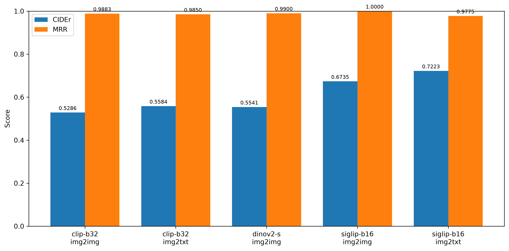

*Figure 12. Validation CIDEr comparison for the five implemented retrieval configurations.*

## 11.3 Official test results (1,000 images)

[Table 10](#table-10-official-test) reports the five retrieval configurations on the official 1,000-image test (COCO val2017; source: `experiments/test_1000_val2017/results/encoder_comparison_test_1000.csv`). The test is disjoint from the KB, validation and legacy test, and its QC report is `experiments/test_1000_val2017/qc/qc_report_test_1000.md`. As for the legacy test, these results are **report-only**: no configuration was selected or re-selected on them.

**Table 10. Official test results (1,000 images, report-only).**

| Configuration | Recall@1 | Recall@5/@10 | Precision@1/@5/@10 | MRR | CIDEr | Random CIDEr |
|---|---:|---:|---:|---:|---:|---:|
| CLIP image-to-image | 0.943 | 0.993 / 0.996 | 0.943 / 0.930 / 0.921 | 0.9651 | 0.4984 | 0.0270 |
| CLIP image-to-text | 0.952 | 0.992 / 0.996 | 0.952 / 0.949 / 0.947 | 0.9705 | 0.5746 | 0.0270 |
| DINOv2 image-to-image | 0.965 | 0.994 / 0.996 | 0.965 / 0.954 / 0.950 | 0.9781 | 0.5309 | 0.0270 |
| SigLIP image-to-image | 0.966 | 0.996 / 0.999 | 0.966 / 0.961 / 0.955 | 0.9804 | 0.5320 | 0.0270 |
| SigLIP image-to-text | 0.973 | 0.999 / 1.000 | 0.973 / 0.966 / 0.963 | 0.9847 | **0.6385** | 0.0270 |

**The ranking agrees with validation and with the legacy test.** SigLIP image-to-text, the validation winner (validation CIDEr 0.7223), has the highest CIDEr of the five configurations on the official test (0.6385), followed by CLIP image-to-text (0.5746). It also has the highest Recall@1 (0.973) and MRR (0.9847). All five configurations remain far above the random-caption baseline (0.0270).

**Provenance of these figures.** Table 10 uses SigLIP text embeddings computed with padding="max_length" (64 tokens), as in notebook 04. An earlier version of Table 10 (SigLIP image-to-text: Recall@1 0.891, MRR 0.9376, CIDEr 0.4645, lowest of the five; CLIP image-to-text highest at 0.5746) used text embeddings recomputed by scripts/recover_kb_embeddings.py with padding=True; we measured that this setting reproduces exactly those earlier figures (mean cosine similarity between the two sets of knowledge-base text embeddings: 0.4842). Which of the two sets matches the SHA256 recorded in the manifest is not established. CLIP image-to-image (0.4978 to 0.4984) and DINOv2 image-to-image (0.5333 to 0.5309) also changed slightly; the cause of these small differences is not established. The PDF version of this report (Section 11.3) was recompiled after this correction and shows the corrected figures.

Interpretation and caveats:

- The ranking on the official test agrees with validation and with the legacy test; the earlier inverted ranking is reproduced by the text-embedding padding setting (see above), which suggests that it is not a failure of the validation selection to generalise. The validation set still has only 100 images and the SigLIP image-to-text 10-fold standard deviation was large (0.1913, Section 11.1), so small differences should not be over-interpreted.
- The repository stores aggregate metrics only, not per-image scores for the 1,000-image test, so **no significance test is reported** for the differences in Table 10. Differences of a few hundredths of CIDEr (e.g. DINOv2 vs SigLIP image-to-image) must not be interpreted as ordering.
- The frozen primary encoder of release g1-v1.1 (`siglip-b16`) was selected by the validation protocol and is not changed after seeing test results (that would be test-set selection). Users of the release should be aware of Table 10 and choose their encoder for their own technique through their own validation protocol; CLIP and DINOv2 embeddings are provided for the same images.
- Retrieval relevance here uses the project's strict Jaccard-based criterion and CIDEr is computed on the nearest-neighbour caption only; no generative model is involved in Phase 1.

## 11.4 Interpretation

Several conclusions are statistically and descriptively supported, with qualifications. SigLIP image-to-text is the validation winner and the leader on both the legacy 100-image test and the official 1,000-image test (Section 11.3). SigLIP image-to-image is not statistically distinguishable from the winner on validation data, so the empirical evidence does not justify treating the 0.0487 validation CIDEr difference as established. CLIP image-to-text, DINOv2 image-to-image, and CLIP image-to-image are each significantly below SigLIP image-to-text under the repository's Bonferroni threshold. A random caption baseline remains substantially lower.

No claim is made that the comparison establishes general superiority of SigLIP across all retrieval settings. The sample has only 100 validation images, 100 legacy test images (and 1,000 official test images without per-image scores or significance tests), one run per configuration in the frozen artifacts, and a nearest-neighbour caption evaluation protocol. Consistency on the legacy and official tests is supportive but not sufficient for broad generalization, and the official test has no per-image scores or significance tests.

# 12. Reproducibility and Dataset Freezing

## 12.1 Configuration and execution

The master configuration records seed 42, release version g1-v1.1, split sizes, caption cardinality, sampling thresholds, image normalization parameters, encoder identifiers, and FAISS settings. Split seeds are 43, 44, and 45 for test, validation, and KB respectively within the pipeline's fixed base seed. The recommended full notebook order begins with annotations and ends with the retrieval demonstration; a dedicated runner exists for frozen SigLIP extraction, QC, freeze verification, synthetic mini-COCO testing, and cached encoder checks.

The frozen runtime recorded by `artifacts/manifest.json` is Python 3.13.7 on Windows 11. Package versions include NumPy 2.5.4, pandas 3.1.0, SciPy 1.18.1, Pillow 13.0.0, Matplotlib 3.11.2, FAISS 1.15.1, PyTorch 2.15.0 CPU, Transformers 5.22.1, and Sentence-Transformers 6.2.0. `requirements.txt` also pins scikit-learn 1.9.1, COCO evaluation tools, sentencepiece, protobuf, imagehash, Jupyter packages, and supporting dependencies.

## 12.2 Manifest and read-only release

The manifest identifies release g1-v1.1, seed 42, primary encoder SigLIP, and 10,270 hashed files. Frozen artifacts are subsequently set read-only. `run_freeze_only.py --verify` checks the manifest SHA-256 values and is documented to print “release identique à la référence” for an intact release.

This manifest guarantees file identity for users receiving the same release. It does not guarantee bitwise identical embeddings when they are regenerated on a different device, especially where hardware, kernels, or dependency behavior changes floating-point results by approximately \(10^{-6}\). It also does not claim that run time remains identical.

The repository preserves historical provenance: manifest v1.0 records CLIP and DINOv2 runtime under Python 3.11.9, PyTorch 2.12.0 CPU, and Transformers 4.57.6. One documentation note for SigLIP says Python 3.13.3, while `manifest.json` records 3.13.7; the report therefore treats the manifest value as the frozen runtime and records the discrepancy as a known documentation limitation.

## 12.3 Dataset freezing

The freeze separates raw input integrity from generated artifact integrity. Split files include SHA-256 hashes of ID lists, while the manifest hashes file content. Verification is performed through content hashes rather than only file names or counts. Any changes to images, embeddings, indexes, splits, or QC artifacts require rebuilding a new release rather than modifying the frozen directory.

# 13. Limitations and Conclusion

## 13.1 Limitations

First, Phase 1 does not implement a caption generator. CIDEr and nearest-neighbour caption baselines measure whether the shared retrieval setup supplies useful candidate text. Language generation, prompt construction, grounding, fluency optimization, and user-facing caption quality remain future work.

Second, the validation and legacy test sets contain only 100 images (the official test has 1,000 images but only aggregate metrics are stored). Although this permits focused stratification, statistical estimates have broad uncertainty and confidence intervals are sensitive to sampling. Ten-fold cross-validation standard deviations are recorded for comparison, but no encoder training was performed and the reported folds are not independent models.

Third, test results are used only for final reporting. The repository also reports no correction for hypotheses tested post hoc after inspecting the test values, which reinforces the need not to select models on test.

Fourth, validation/test object metadata is sourced from COCO ground-truth annotations. A deployed system would use detector outputs, which are inherently noisy. The optional DETR path exists for more realistic experiments, but it is not the source of the frozen metadata used by the reported results.

Fifth, the geometric relation model captures only pairwise bounding-box relations. It cannot represent true semantic dependencies, human intent, or contextual scene graphs. Likewise, caption attributes use fixed vocabulary lexicons and cannot cover unseen paraphrases or semantic composition.

Sixth, text similarity checks can identify repeated generic captions that do not imply image identity. Exact-caption matches therefore require careful interpretation and are not automatically treated as leakage. Conversely, negative exact and near-duplicate checks are evidence for the tested thresholds, not proof against every possible visual, semantic, or annotation transformation.

Seventh, cross-run embedding reproducibility has hardware and implementation dependencies. GPU outputs can differ slightly, and the frozen files rather than a claim of universal bitwise reproducibility provide the identity guarantee.

Eighth, index reports and search benchmarks use different timing mechanisms. NumPy exact-search latency in the comparison script is explicitly not comparable to FAISS measurements. Index build times and query latency should therefore not be combined with caption-generation latency.

Finally, the repository contains a provenance discrepancy between a separate SigLIP environment note and the manifest's Python version. The manifest remains the safer frozen release authority, but documentation consumers should be aware that the note says Python 3.13.3 whereas the manifest says 3.13.7.

## 13.2 Conclusion

Phase 1 establishes a coherent, auditable foundation for later RAG-based caption generation. Its principal implemented results are a 10,200-image frozen release, two hundred stratified evaluation images with five references each, normalized image and caption data, 80-class ground-truth metadata, multiple image/text embedding products, exact and approximate indexes, 11 EDA visualizations, 40 quality-control checks, and a content-based anti-leakage audit.

Within the implemented nearest-neighbour evaluation, validation selects SigLIP image-to-text by CIDEr. Its validation result is 0.7223, and its report-only test result is 0.7064. SigLIP image-to-image is numerically lower but not significantly worse on validation. The comparison also shows that final encoder choice is supported by validation evidence and remains consistent with the final test trend, while avoiding the methodological error of making a test-selected decision.

The release is complete for Phase 1's data and retrieval-preparation scope. Its limitations—especially evaluation size, metadata-oracle status, geometric relations, and the absence of a final language generator—provide explicit boundaries for subsequent Phase 2 implementation and should remain part of any comparative report.

# References

[1] Lin, T.-Y., Maire, M., Belongie, S., Hays, J., Perona, P., Ramanan, D., Dollár, P., and Zitnick, C. L. “Microsoft COCO: Common Objects in Context.” *European Conference on Computer Vision*, 2014.

[2] Vedantam, R., Lawrence Zitnick, C., and Parikh, D. “CIDEr: Consensus-Based Image Description Evaluation.” *IEEE Conference on Computer Vision and Pattern Recognition*, 2015.

[3] Radford, A., Kim, J. W., Hallacy, C., et al. “Learning Transferable Visual Models from Natural Language Supervision.” *International Conference on Machine Learning*, 2021.

[4] Oquab, M., Darcet, T., Moutakanni, T., et al. “DINOv2: Learning Robust Visual Features without Supervision.” arXiv:2304.07193, 2023.

[5] Zhai, X., Mustafa, B., Kolesnikov, A., and Beyer, L. “Sigmoid Loss for Language Image Pre-Training.” *International Conference on Computer Vision*, 2023.

[6] Reimers, N. and Gurevych, I. “Sentence-BERT: Sentence Embeddings using Siamese BERT-Networks.” *Proceedings of EMNLI*, 2019.

[7] Johnson, J., Douze, M., and Jégou, H. “Billion-scale similarity search with GPUs.” *IEEE Transactions on Big Data*, 2019.

[8] Cohen, J. *Statistical Power Analysis for the Behavioral Sciences*. 2nd ed., Lawrence Erlbaum Associates, 1988. Used here only as methodological context; repository-specific significance decisions are reported from the recorded Wilcoxon values and Bonferroni threshold.

