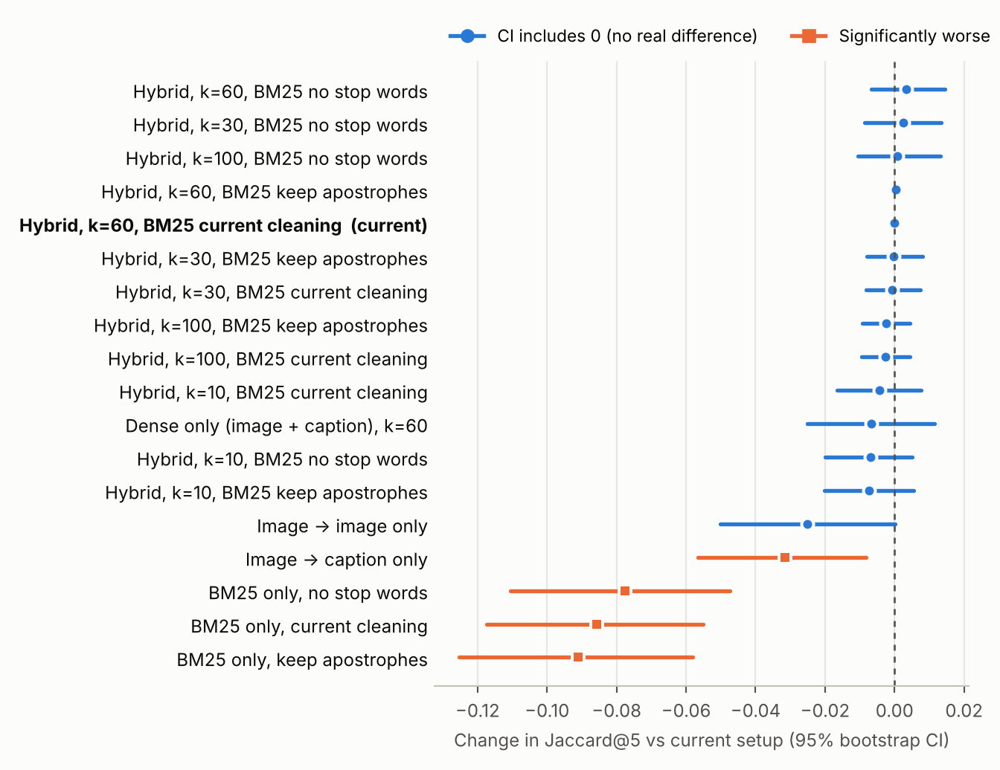

# G9 — Hybrid RAG for Image Captioning (MS COCO)

A comparative study of Retrieval-Augmented Generation (RAG) techniques for image captioning.
**Group G9 · Technique: Hybrid RAG (dense CLIP retrieval + sparse BM25, fused with Reciprocal Rank Fusion).**


## Project status

| Phase | Deadline | Status |
|---|---|---|
| 1. Data exploration & preprocessing | 4 Nov 2026 | ✅ Done — *ready for review, not frozen* (one open point: stratified test set, see [Open issues](#open-issues)) |
| 2. Model training & validation | 2 Dec 2026 | ⏳ Not started (`notebooks/02_baseline_and_rag`, `03_tuning_and_ablation`) |
| 3. Model evaluation | 21 Dec 2026 | ⏳ Not started (`notebooks/04_evaluation_and_stats`) |

## Preprocessing results (Phase 1)

- **Splits** (seed 42): knowledge base 10,000 (train2017) · validation 100 · test 100 (val2017). No overlap. Files in [`data/splits/`](data/splits/).
- **Captions**: 50,000 (5 per image); raw kept for evaluation, cleaned copy used only for BM25.
- **Embeddings**: CLIP ViT-B/32, 512-d, L2-normalised (10,000 image + 50,000 text vectors). **Row alignment verified** (min cosine ≥ 0.9999997 on 100 + 100 re-embedded rows).
- **Indexes**: FAISS `IndexFlatIP` (images, captions) + BM25Okapi. Build times 0.014 s / 0.153 s / 1.011 s.
- **Metadata**: one record per image for all 10,200 ([`data/metadata/image_metadata.csv`](data/metadata/image_metadata.csv)). KB objects = COCO labels; val/test objects = DETR detector. Every field names its source.
- **Validation choice** (§4.4.4): 18 retrieval set-ups compared on 98 scorable validation images (object-category Jaccard@5, paired bootstrap). Best = +0.003 vs current, 95% CI [−0.007, 0.014] → **keep current config** (hybrid, RRF k = 60, current BM25 cleaning). [`results/preprocessing_release/validation_selection.csv`](results/preprocessing_release/validation_selection.csv)
- **Audit**: 13/13 checks pass in the last run; 4 new checks (alignment, config, metadata, validation) pass on the new files. Re-run notebook 06 part B to write all 17 into [`preprocessing_audit.json`](results/preprocessing_release/preprocessing_audit.json).
- **EDA**: all 80 COCO categories, 7.21 objects/image (median 4), captions 10.49 words avg, vocabulary 9,770.



Full write-up: [`raport/Image Preprocessing in the G9 Hybrid RAG Project.pdf`](raport/) (HTML source in `docs/report/source/`).

## Repository layout

```
.
├── README.md
├── requirements.txt
├── .gitignore
├── configs/                  # seed, model names, paths (preprocessing.yaml)
├── raport/                   # preprocessing report (PDF)
├── docs/
│   ├── assignment/           # official project brief (PDF)
│   ├── report/source/        # HTML source of the report (rebuild with Chrome: print to PDF)
│   ├── diagrams/             # pipeline / split / retrieval diagrams (.dot, .png, .svg)
│   ├── DRIVE_ARTIFACTS.md    # where the large files live on Google Drive
│   └── OPEN_ISSUES.md
├── notebooks/
│   ├── preprocessing/        # Phase 1 — one job per notebook, run in order on Colab
│   │   ├── 01_data_setup_and_splits.ipynb
│   │   ├── 02_preprocessing.ipynb
│   │   ├── 03_eda.ipynb
│   │   ├── 04_embeddings_and_indexes.ipynb
│   │   ├── 05_image_metadata.ipynb
│   │   └── 06_validation_and_release_audit.ipynb
│   ├── 02_baseline_and_rag/          # Phase 2: no-RAG baseline + Hybrid RAG pipeline
│   ├── 03_tuning_and_ablation/       # Phase 2: top_k, temperature, ablations
│   └── 04_evaluation_and_stats/      # Phase 3: metrics, hallucinations, statistical tests
├── src/                      # modular code (to be extracted from notebooks)
│   ├── preprocessing/  retrieval/  generation/  evaluation/
├── data/                     # small tracked files; large ones live on Drive (see below)
│   ├── splits/  preprocessed_captions/  metadata/  embeddings/  indexes/
├── results/
│   ├── eda/                  # statistics (CSV/JSON)
│   ├── qa/                   # quality-control reports
│   ├── retrieval/            # index statistics, smoke tests
│   └── preprocessing_release/
├── outputs/
│   ├── figures/              # PNGs regenerated by scripts/make_figures.py
│   └── generated_captions/   # Phase 2/3 deliverable (CSV/JSON)
├── scripts/                  # make_figures.py, make_validation_figure.py
└── tests/
```

## Reproducing Phase 1

| # | Notebook | Job | GPU |
|---|---|---|---|
| 01 | `01_data_setup_and_splits` | COCO files, splits, image archives, scoped annotations, test balance | – |
| 02 | `02_preprocessing` | Image pipeline + audit of 10,200 images, caption cleaning, leakage check | – |
| 03 | `03_eda` | Captions, words, POS, objects, co-occurrence, complexity, colour/context cues, box geometry | – |
| 04 | `04_embeddings_and_indexes` | CLIP vectors, FAISS + BM25, retrieval smoke tests, alignment check | T4 |
| 05 | `05_image_metadata` | One metadata record per image (10,200) | T4 |
| 06 | `06_validation_and_release_audit` | A: choose config on validation · B: final audit + release files | T4 (A) |

1. Open the notebooks in Colab and run them in order `01 → 06`.
2. They mount Google Drive and read/write `MyDrive/G9_Hybrid_RAG/` (set by `ROOT`/`PROJECT_DIR`). The layout there mirrors `data/` and `results/` here.
3. Saved outputs are from the real Colab runs; cells that were added or edited during the reorganisation have no output yet.
4. Regenerate figures locally: `pip install -r requirements.txt && python scripts/make_figures.py && python scripts/make_validation_figure.py`.

> ⚠️ Never change split IDs or overwrite embeddings/indexes without regenerating every split-dependent artifact. Do not load `bm25.pkl` from untrusted sources (pickle).

## Anti-leakage rules (from the brief)

Test-image reference captions are never in the knowledge base, never used for retrieval/generation, and a test image is never retrieved for itself (KB = train2017, test = val2017, so this holds by construction).

## Open issues

See [`docs/OPEN_ISSUES.md`](docs/OPEN_ISSUES.md). Main one: the test set (100 images) is a random draw, but the brief asks for a *stratified* subset shared by all groups.

## Team

Group G9 — Hybrid RAG (with G7 and G8 sharing the same technique).
