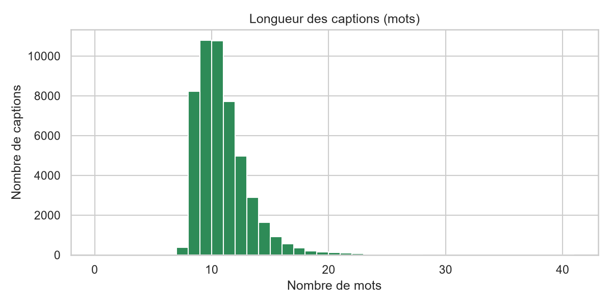
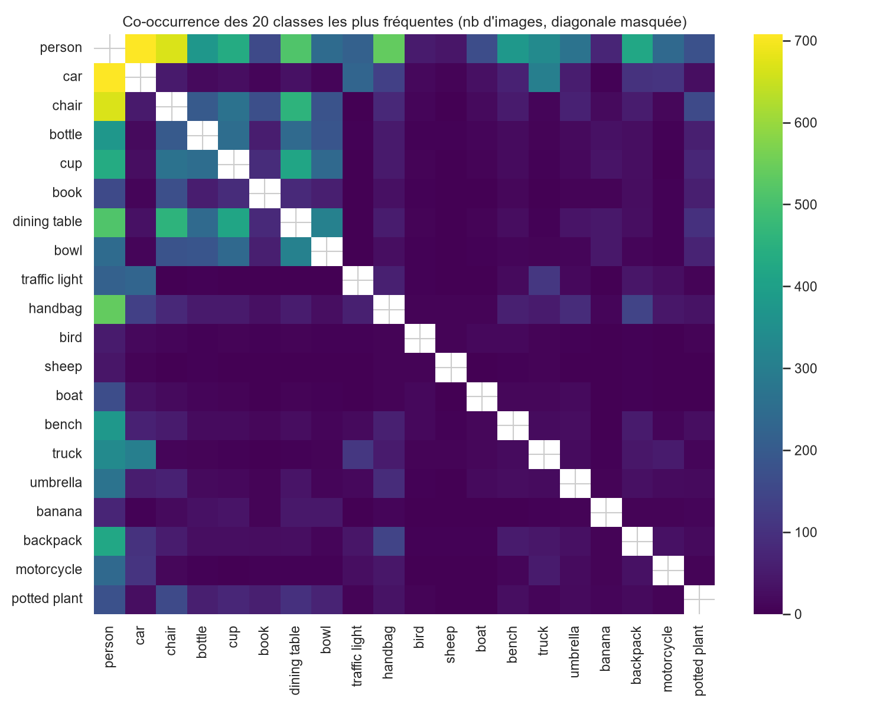
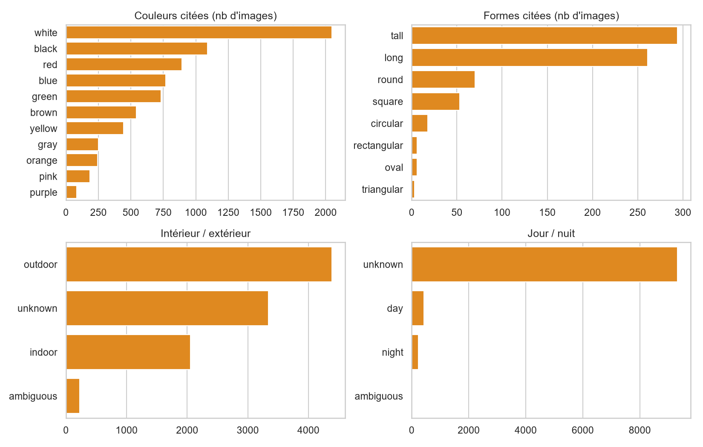
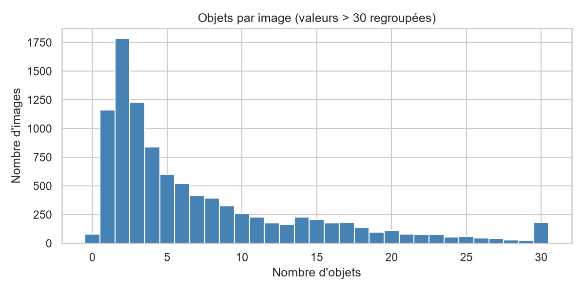
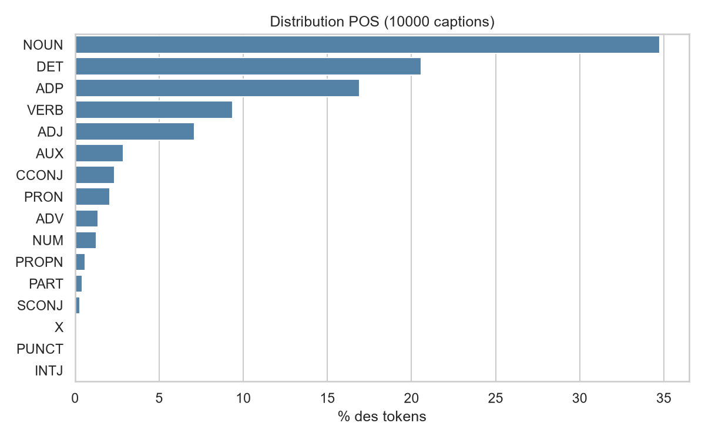
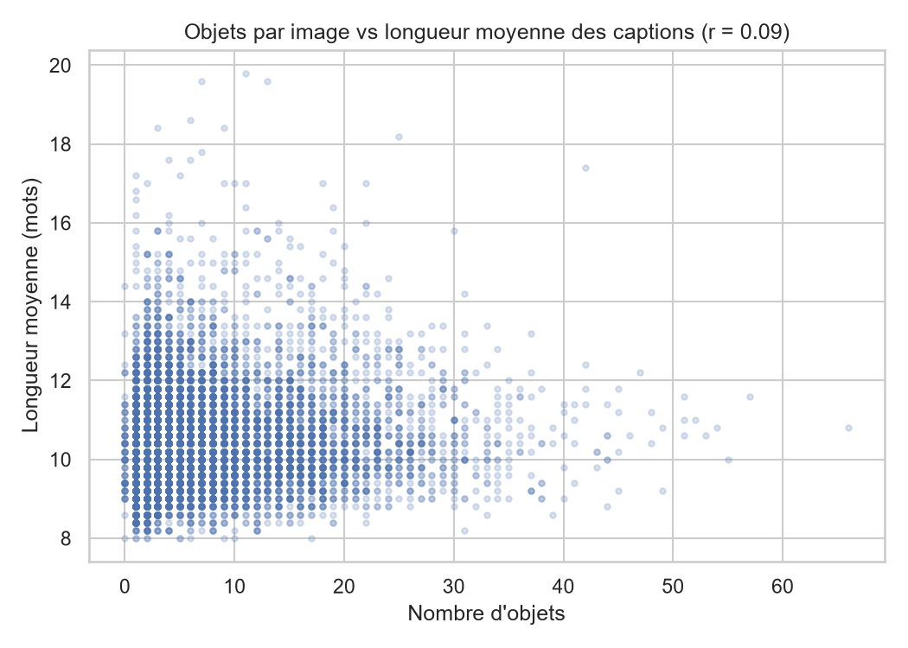
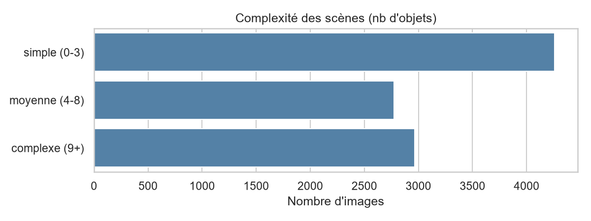
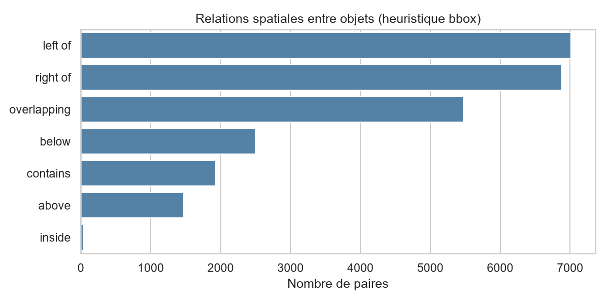
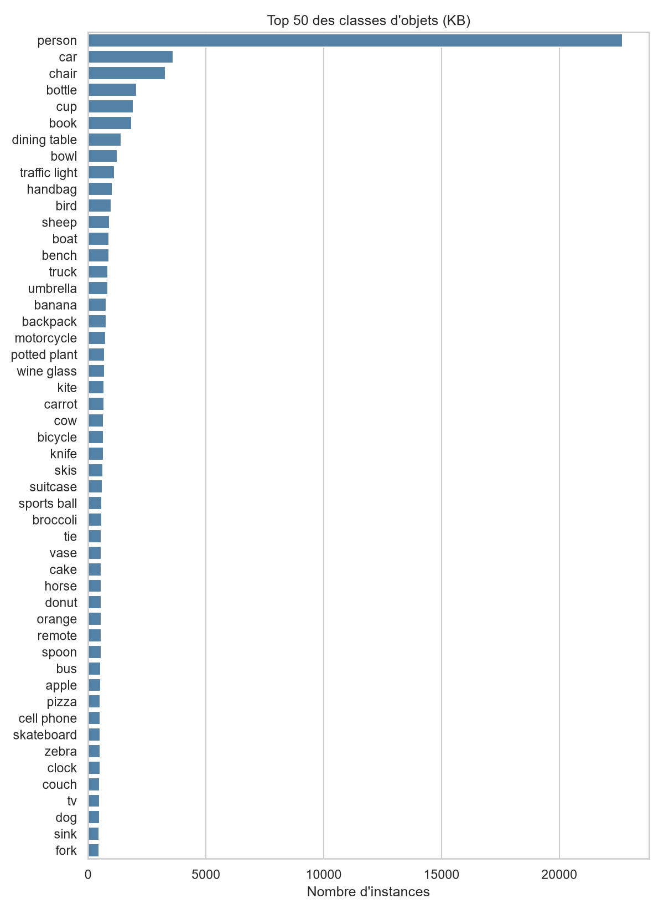
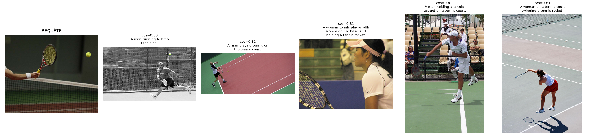

# Rapport Phase 1 — Exploration et prétraitement des données

## 1. Audit et nettoyage
- Fichiers analysés : 10300
- Statuts : {'ok': 10300}
- Doublons exacts supprimés : 0
- Quasi-doublons visuels signalés : 0 (supprimés : False)
- Images propres : 10300

## 2. Splits (figés, seed 42)
| Split | Taille | Source |
|---|---|---|
| Base de connaissances | 10000 | COCO train2017 |
| Validation | 100 | train2017 (dans la KB : False) |
| Test | 100 | val2017 — stratified_by_object_count_quartiles(val2017) |

- Audit anti-fuite : `{'kb_inter_val': 0, 'kb_inter_test': 0, 'val_inter_test': 0, 'test_md5_in_kb_or_val': 0, 'test_candidates_removed_for_visual_overlap': 0, 'test_min_phash_distance_to_kb_val': 10, 'passed': True}`
- Strates du test : {'simple': 25, 'moyenne': 25, 'complexe': 25, 'tres_complexe': 25}

### Points à confirmer avec le professeur
- Taille du test : 100 ou 1 000 images (le PDF est incohérent) ?
- Validation disjointe de la KB (choix actuel) ou incluse dans la KB ?

## 3. Exploration statistique
- Classes présentes : 80 ; top 10 : {'person': 22677, 'car': 3612, 'chair': 3291, 'bottle': 2062, 'cup': 1914, 'book': 1850, 'dining table': 1406, 'bowl': 1237, 'traffic light': 1128, 'handbag': 1034}
- Objets/image : moyenne 7.34, médiane 4.0, max 66
- Complexité des scènes : {'simple (0-3)': 4260, 'moyenne (4-8)': 2773, 'complexe (9+)': 2967}
- Captions : 50000 ; longueur moyenne 10.48 mots (min 7, max 49) ; vocabulaire 9846
- POS (%) : {'NOUN': 34.76, 'DET': 20.58, 'ADP': 16.92, 'VERB': 9.36, 'ADJ': 7.11, 'AUX': 2.89, 'CCONJ': 2.34, 'PRON': 2.08, 'ADV': 1.39, 'NUM': 1.25, 'PROPN': 0.6, 'PART': 0.41, 'SCONJ': 0.28, 'X': 0.01, 'PUNCT': 0.01, 'INTJ': 0.0}

## 4. Prétraitement des images
- Modes : {'RGB': 9984, 'L': 16} ; orientation EXIF corrigée : 0
- Encodeur : openai/clip-vit-base-patch32 — resize {'shortest_edge': 224}, crop {'height': 224, 'width': 224}
- Normalisation : mean [0.48145466, 0.4578275, 0.40821073], std [0.26862954, 0.26130258, 0.27577711]

## 5. Captions et métadonnées
- Captions brutes conservées telles quelles ; version nettoyée uniquement pour l'indexation.
- Métadonnées **COCO** (réelles) : `data/metadata/coco_objects_*.json`.
- Métadonnées **dérivées** (heuristiques captions/bbox, pas de modèle IA) : `data/metadata/derived_metadata_*.json`.
- Fichiers `*_EVAL_ONLY` : références du test, réservées à l'évaluation.

## 6. Embeddings
- Modèle : openai/clip-vit-base-patch32 ; dimension 512 ; normalisation : L2 (norme = 1) -> produit scalaire = similarité cosinus
- Images KB : {'shape': [10000, 512], 'seconds': 1447.1} ; captions KB : {'shape': [50000, 512], 'seconds': 1466.3}

## 7. Index FAISS
- {'index_type': 'IndexIDMap(IndexFlatIP)  (recherche exacte)', 'metric': 'inner product sur vecteurs L2-normalisés = similarité cosinus', 'dimension': 512, 'n_image_vectors': 10000, 'n_text_vectors': 50000, 'build_seconds_images': 0.0055, 'index_file_mb': 20.56, 'text_index_file_mb': 102.8, 'avg_search_latency_ms': 0.412, 'faiss_version': '1.15.1'}

## 8. Contrôle qualité
- Tous les tests réussis : **True**

| Vérification | Résultat |
|---|---|
| Taille KB | PASS |
| Taille validation | PASS |
| Taille test | PASS |
| Pas d'ID dupliqué dans chaque split | PASS |
| KB ∩ test = ∅ | PASS |
| Val ∩ test = ∅ | PASS |
| KB ∩ val = ∅ | PASS |
| Embeddings images = 1 par image KB | PASS |
| Embeddings texte = 5 par image KB | PASS |
| Aucun NaN/Inf (images et texte) | PASS |
| Vecteurs normalisés (norme ≈ 1) | PASS |
| Aucun vecteur image nul | PASS |
| Embeddings requêtes val | PASS |
| Embeddings requêtes test | PASS |
| 5 captions brutes par image KB | PASS |
| Captions brutes identiques à COCO (non modifiées) | PASS |
| text_index.csv aligné avec les embeddings texte | PASS |
| Aucune image de test dans captions / métadonnées / embeddings KB | PASS |
| Audit anti-fuite (doublons exacts/visuels test vs KB/val) | PASS |
| FAISS : ntotal = nb images KB | PASS |
| FAISS texte : ntotal = nb captions | PASS |
| FAISS : chaque image KB se retrouve elle-même en top-1 | PASS |
| FAISS : requêtes validation renvoient 5 résultats valides | PASS |
| FAISS : aucun résultat ne pointe vers une image de test | PASS |